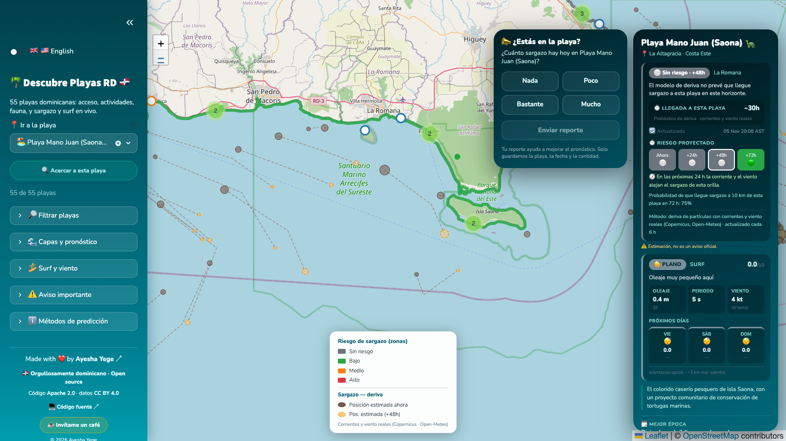
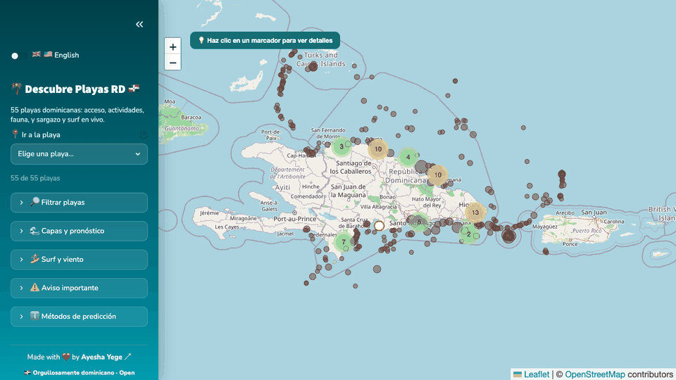
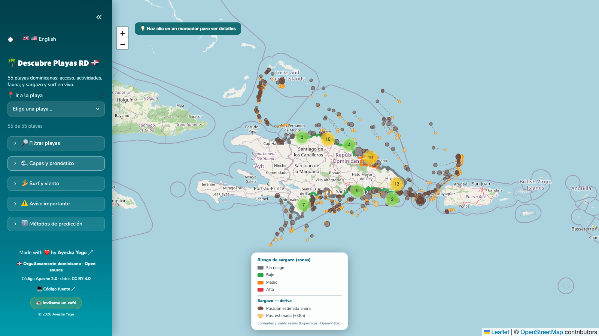
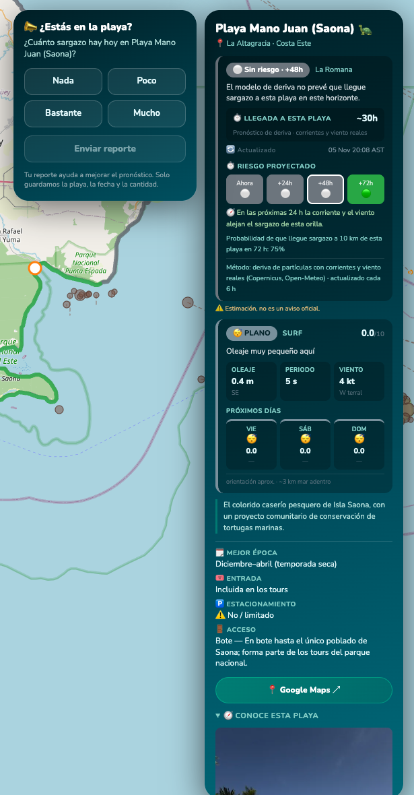
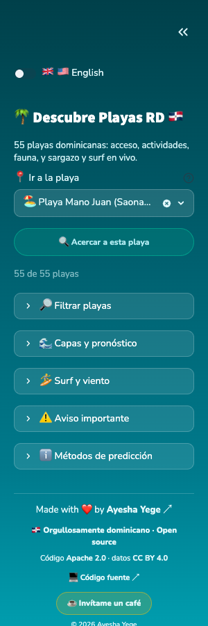

# 🌊 Sargassum Detection & Early-Warning System

> **POC** · Dominican Republic EEZ · Free-tier · ~$0/month

Detects floating sargassum from satellite imagery, models its drift with ocean currents and wind, computes arrival probabilities and ETAs for 14 DR coastal zones and each of 55 beaches, and sends Telegram alerts to fishermen and hotels.
Also ships a tourist **beach explorer** — 55 DR beaches with live sargassum risk, per-beach arrival time estimates, a "Conoce esta playa" panel on each beach's wildlife, activities, parking, and Google Maps links.
An ML extended forecast layer adds 7 / 14 / 21-day outlooks that bridge the gap between the 72-hour physics drift model and monthly seasonal climatology.

<p align="center">
  
</p>

<p align="center">
  <em>Detected sargassum masses (brown) drifting across the DR EEZ, monitoring zones (dashed), and per-beach risk with arrival ETA.</em>
</p>

**Contents:** [Quick start](#quick-start-5-minutes-to-a-running-dashboard) · [Environment variables](#environment-variables) · [Architecture](#architecture) · [API](#api-reference) · [Database](#database-schema) · [Telegram](#telegram-bot-commands) · [Deployment](#deployment) · [Risk calculation](#how-sargassum-risk-is-calculated) · [Beach explorer](#beach-explorer-features) · [Conoce esta playa](#conoce-esta-playa) · [Adding a beach photo](#adding-a-beach-photo) · [Surf & wind](#surf--wind-conditions) · [Testing](#testing) · [Limitations](#limitations-and-known-gaps) · [License](#license)

---

## Quick start (5 minutes to a running dashboard)

You don't need any credentials to run the beach explorer: steps 1–3 and 7 are enough. Supabase is only for the API and pipeline, and Earth Engine and Copernicus credentials only for the detection pipeline.

```bash
# 1 — clone & enter the repo
git clone https://github.com/Ayege/descubreplayas.git
cd descubreplayas

# 2 — create a Python 3.11 virtual environment
python3.11 -m venv .venv
source .venv/bin/activate        # Windows: .venv\Scripts\activate

# 3 — install all dependencies
pip install -r requirements.txt

# 4 — copy the env template and fill in your values (see table below)
cp .env.example .env

# 5 — optional: provision the database (run once in the Supabase SQL editor)
#     open sql/schema.sql and execute it in your Supabase project

# 6 — optional: seed the beach catalog into Supabase. This writes to the project in
#     your .env. It adds and updates beaches, but never deletes one removed from the
#     catalogue, so delete those rows yourself.
python -m scripts.seed_beaches

# 7 — launch the beach explorer (works offline — no API needed)
streamlit run dashboard/beaches.py
```

Open http://localhost:8501 — you'll see the interactive tropical map with 55 DR beaches.

> **To see detected sargassum on the map, the API has to be running too.** The
> explorer reads masses from `GET /detections`, so with `API_BASE_URL` pointing
> at a host that is down the map shows beaches but no sargassum. Start the API
> (below) in a second terminal and reload.

### Also run the API and risk map

```bash
# API (separate terminal)
uvicorn api.main:app --reload
# → http://localhost:8000/docs for interactive API docs

# Coastal risk map
streamlit run dashboard/app.py

# Full detection pipeline (requires EE + CMEMS credentials)
python -m pipeline.run
```

---

## Environment variables

Copy `.env.example` to `.env` and fill in every variable.
**Secrets are never hardcoded** — all config comes from the environment.

| Variable                    | Required for           | Description                                                           |
| --------------------------- | ---------------------- | --------------------------------------------------------------------- |
| `EE_PROJECT`              | Pipeline               | Google Cloud project with Earth Engine enabled                        |
| `EE_SERVICE_ACCOUNT_JSON` | Pipeline               | Path to service-account key file**or** the JSON string          |
| `CMEMS_USERNAME`          | Pipeline               | Copernicus Marine username                                            |
| `CMEMS_PASSWORD`          | Pipeline               | Copernicus Marine password                                            |
| `SUPABASE_URL`            | All                    | Supabase project URL                                                  |
| `SUPABASE_KEY`            | All                    | Service-role key (pipeline/API) or anon key (read-only)               |
| `TELEGRAM_BOT_TOKEN`      | Alerts                 | Bot token from @BotFather                                             |
| `TELEGRAM_WEBHOOK_SECRET` | Alerts                 | Shared secret echoed in Telegram's webhook header (prevents spoofing) |
| `API_BASE_URL`            | Dashboard risk overlay | Public API URL. Unset, it uses the production API; blank skips live risk |
| `FORECAST_HOURS_PHYSICS`  | Pipeline (optional)    | Physics drift horizon in hours (default`72`)                        |
| `FORECAST_HOURS_EXTENDED` | Pipeline (optional)    | ML forecast horizon cap in hours (default`168` = 7 d)               |
| `ML_RETRAIN_EVERY_N_RUNS` | Pipeline (optional)    | Retrain ML model every N pipeline runs (default`28` ≈ 1 week)      |
| `WIND_DRIFT_FACTOR`       | Pipeline (optional)    | Central windage, used with a single particle (default `0.01`)       |
| `FAI_THRESHOLD`           | Pipeline (optional)    | Floating Algae Index detection threshold (default`0.005`)           |
| `AFAI_ENABLED`            | Pipeline (optional)    | Compare with NOAA/USF daily AFAI each run (default `1`)              |
| `AFAI_GAP_FILL`           | Pipeline (optional)    | Add AFAI clusters Sentinel-2 missed as detections (default `1`)      |
| `AFAI_ANOMALY_THRESHOLD`  | Pipeline (optional)    | AFAI above local background to flag a cell (default `0.001`)         |
| `AFAI_MATCH_KM`           | Pipeline (optional)    | Distance at which S2 and AFAI detections count as the same mass (default `15`) |
| `ML_REQUIRE_SKILL`        | Pipeline (optional)    | Use the ML model only if it beat seasonal at its last training (default `1`) |
| `ML_EVAL_FOLDS`           | Pipeline (optional)    | Walk-forward folds used to score the model (default `3`)             |
| `CURRENTS_INCLUDE_STOKES` | Pipeline (optional)    | Use Copernicus merged currents with tides + Stokes drift (default `1`) |
| `WIND_DRIFT_MIN` / `WIND_DRIFT_MAX` | Pipeline (optional) | Windage range sampled by the ensemble (default `0.005`–`0.015`) |
| `DRIFT_PARTICLES`         | Pipeline (optional)    | Particles (= ensemble members) per patch (default `24`)              |
| `ARRIVAL_KM`              | Pipeline (optional)    | Distance from the coast that counts as arrival (default `3`)         |
| `DRIFT_PRESENT_HOURS`     | Pipeline (optional)    | Catch-up arrivals this recent count as present now (default `48`)    |
| `RISK_PROB_THRESHOLD`     | Pipeline (optional)    | Share of members needed for the headline risk level (default `0.5`)  |
| `CLOUD_SCORE_MIN`         | Pipeline (optional)    | Cloud Score+ clear-sky threshold (default `0.6`)                     |
| `COAST_BUFFER_M`          | Pipeline (optional)    | Shoreline strip excluded from detection (default `300`)              |
| `ML_MIN_REPORT_ROWS`      | Pipeline (optional)    | Report rows needed to train on visitor reports (default `150`)       |
| `ML_TRAIN_VERSIONS`       | Pipeline (optional)    | zone_features drift versions used for training (default: current version) |
| `MIN_REPORTS_PER_LABEL`   | Pipeline (optional)    | Reports needed for a zone-day or beach-day label (default `1`)       |
| `RISK_AREA_FIELD`         | Pipeline (optional)    | `area_km2` (outline) or `covered_km2` for the risk thresholds (default `area_km2`) |
| `BEACH_RADIUS_KM`         | Pipeline (optional)    | Arrivals this close count for a beach's own forecast (default `10`)  |
| `DRIFT_MODEL_VERSION` / `ML_MODEL_VERSION` | Pipeline (optional) | Version stamped on stored forecasts; bump when the model changes |
| `ZONE_BOX_HALF_DEG`       | Pipeline (optional)    | Half-width of each zone's detection box in degrees (default`0.35`)  |
| `CORS_ORIGINS`            | API (optional)         | Origins allowed to call the API                                       |
| `APP_CANONICAL_URL`       | Dashboard (optional)   | Canonical site URL for SEO tags                                       |
| `APP_OG_IMAGE_URL`        | Dashboard (optional)   | Social preview image URL                                              |
| `GA_MEASUREMENT_ID`       | Dashboard (optional)   | Google Analytics 4 ID                                                 |
| `DONATE_URL`              | Dashboard (optional)   | Donation link in the sidebar                                          |

> **Beach explorer with no credentials** — leave `API_BASE_URL` blank.
> The map loads from the built-in dataset; the sargassum risk badges show "no data".
> Set `SUPABASE_URL`/`SUPABASE_KEY` + `API_BASE_URL` to unlock live risk overlays.

---

## Architecture

```
┌────────────┐   ┌─────────────┐   ┌───────────────┐   ┌───────────┐   ┌────────────┐
│  detect.py │ → │  ocean.py   │ → │   drift.py    │ → │  store.py │ → │dispatch.py │
│  (GEE/FAI) │   │ (CMEMS cur) │   │ (Lagrangian)  │   │ (Supabase)│   │ (Telegram) │
└────────────┘   └─────────────┘   └───────────────┘   └───────────┘   └────────────┘
                                                               │
                                         ┌─────────────────────┤
                                         ▼                     │
                                  ┌────────────┐               │
                                  │  model.py  │ (Step 6)      │
                                  │  7/14/21d  │               │
                                  │ ML forecast│               │
                                  └─────┬──────┘               │
                                        │ upsert_ml_forecasts   │
                              ┌─────────▼──────────────────────┤
                              ▼                                ▼
                       ┌────────────┐                  ┌───────────────┐
                       │  FastAPI   │                  │   Streamlit   │
                       │  api/      │                  │  dashboard/   │
                       └────────────┘                  └───────────────┘
```

**Forecast horizons handled by each step:**

| Step | Module                  | Horizon       | Method                                                              |
| ---- | ----------------------- | ------------- | ------------------------------------------------------------------- |
| 1–4 | `detect` → `drift` | 0–72 h       | Physics (Lagrangian advection + CMEMS currents)                     |
| 6    | `model.py`            | 7 / 14 / 21 d | ML (GradientBoostingClassifier), falls back to seasonal climatology |
| —   | `climatology.py`      | Monthly       | Caribbean seasonal index (always available, coarsest)               |

### Repo layout

| Path                          | Purpose                                                                  |
| ----------------------------- | ------------------------------------------------------------------------ |
| `pipeline/detect.py`        | GEE Sentinel-2 FAI detection → patch polygons                           |
| `pipeline/ocean.py`         | Copernicus Marine current + Open-Meteo wind fetch                        |
| `pipeline/drift.py`         | Lagrangian advection → 72-h zone ETA + risk                             |
| `pipeline/features.py`      | Feature engineering for the ML model (12-element vector)                 |
| `pipeline/model.py`         | GradientBoostingClassifier — 7 / 14 / 21-day extended forecasts         |
| `pipeline/store.py`         | Upsert detections, forecasts, and ML forecasts to Supabase               |
| `pipeline/dispatch.py`      | Match forecasts to subscribers, de-duplicate, send Telegram alerts       |
| `pipeline/run.py`           | Orchestrate all 6 steps; graceful per-step error handling                |
| `pipeline/config.py`        | EEZ bbox, zones, thresholds, ML settings — all from env vars            |
| `api/`                      | FastAPI: health, zones, forecasts, extended forecasts, beaches, Telegram |
| `dashboard/beaches.py`      | Streamlit beach explorer (tropical UI, bilingual ES/EN)                  |
| `dashboard/beaches_data.py` | 55-beach offline dataset (canonical, English — filters and API key on it) |
| `dashboard/beaches_i18n.py` | Spanish display layer: 183 vocabulary terms + prose for all 55 beaches   |
| `dashboard/climatology.py`  | Caribbean monthly risk index (seasonal fallback)                         |
| `dashboard/risk_overlay.py` | Live risk fetch + nearest-zone mapping                                   |
| `dashboard/surf.py`         | Live surf/kite scoring from Open-Meteo wave + wind (no stored data)      |
| `dashboard/surf_data.py`    | Per-beach shore orientation and swell/wind windows used to score surf    |
| `dashboard/conoce.py`       | Renders the "Conoce esta playa" panel; every value is escaped            |
| `dashboard/conoce_data.py`  | Validates and indexes species, photos and hand-written beach content     |
| `dashboard/beach_profiles.py` | Hand-written beach content, with sources                               |
| `dashboard/map_perf.py`     | Parallel loading, compact map markers, smooth map and card motion        |
| `dashboard/data/`           | `species_auto.json` (generated) and `beach_photos.json` (reviewed)       |
| `dashboard/static/`         | Self-hosted images, re-encoded with no metadata, served at `/app/static/` |
| `sql/schema.sql`            | PostGIS tables, seed zones (including La Romana), indexes, RLS policies  |
| `scripts/seed_beaches.py`   | Idempotent Supabase beach seeder                                         |
| `scripts/fetch_species.py`  | Refreshes species data and thumbnails from iNaturalist and OBIS          |
| `scripts/beach_photo_candidates.py` | Lists Commons photos near each beach for review                  |
| `scripts/review_photos.py`  | Local-only server for choosing photos in the browser                     |
| `scripts/import_beach_photo.py` | The only script that writes beach photos                             |
| `requirements/`             | Hashed lockfiles per service; see [its README](requirements/README.md)   |
| `.github/workflows/`        | `ci.yml` (tests + security scans), `deploy.yml` (Cloud Run), `pipeline.yml` (cron every 6 h), `keepalive.yml` (daily ping) |

---

## API reference

| Method   | Endpoint                | Description                                                    |
| -------- | ----------------------- | -------------------------------------------------------------- |
| `GET`  | `/health`             | Liveness + DB connectivity                                     |
| `GET`  | `/zones`              | All monitored coastal zones                                    |
| `GET`  | `/forecast`           | Latest 72-h physics forecast for every zone                    |
| `GET`  | `/forecast/{zone_id}` | Latest 72-h physics forecast for one zone                      |
| `GET`  | `/forecast/extended`  | ML extended forecasts (7/14/21 d); filter with`?lead_days=7` |
| `GET`  | `/beaches`            | Beach catalog (`?province=` / `?region=` filters)          |
| `GET`  | `/detections`         | Latest detected sargassum masses (lat/lon + area);`?limit=`  |
| `POST` | `/subscribe`          | Subscribe a Telegram chat to a zone                            |
| `GET`  | `/forecast/beaches`   | Latest pipeline forecast for every beach (risk, ETA, probabilities, horizons) |
| `POST` | `/reports`            | A visitor's own sighting: `{beach, amount, observed_on?}` (today or yesterday) |
| `POST` | `/telegram/webhook`   | Telegram Bot API update handler                                |

Interactive docs at `/docs` when the API is running.

---

## Database schema

| Table            | Description                                                                    |
| ---------------- | ------------------------------------------------------------------------------ |
| `zones`        | 14 coastal monitoring zones (centre points; `coast` = the coastline each zone owns; `geom` = legacy display boxes) |
| `detections`   | Sargassum patches detected from satellite imagery (polygon + centroid + area)  |
| `forecasts`    | 72-h physics zone risk + ETA per pipeline run (with optional`horizons` JSON) |
| `ml_forecasts` | ML extended forecasts per (zone, lead_days); unique on (run_at, zone, lead)    |
| `subscribers`  | Telegram subscribers per zone                                                  |
| `beaches`      | 55 DR beaches with metadata + PostGIS point geometry                           |
| `beach_reports` | What visitors saw on a beach (`none`…`high`) — the ground truth forecasts are scored against. Service role only |
| `zone_features` | Per-run, per-zone inputs of the extended model, written each run             |
| `detection_checks` | Per-run agreement between Sentinel-2 and NOAA/USF AFAI, and AFAI gap fill |
| `model_evaluations` | Walk-forward scores of the extended model vs its baselines at each training |
| `beach_forecasts` | The pipeline's 72-h forecast per beach (particles stopping within `BEACH_RADIUS_KM`); what the card shows and reports are scored on |

Risk levels: `none` · `low` · `medium` · `high`

**Monitored zones (14):** Punta Cana · Bavaro · Samana · Puerto Plata · Juan Dolio · Barahona · Pedernales · Monte Cristi · Rio San Juan · Azua · La Romana · **Punta Rucia** · **Santo Domingo** · **Miches** *(the last three cover coast that belonged to no zone once arrivals were counted at the coastline)*

---

## Telegram bot commands

Once deployed and webhook registered:

| Command               | Action                                                         |
| --------------------- | -------------------------------------------------------------- |
| `/start`            | Welcome message + usage                                        |
| `/subscribe <zone>` | Subscribe to alerts for a zone (e.g.`/subscribe Punta Cana`) |
| `/status`           | Show current risk for all zones                                |
| `/stop`             | Unsubscribe from all alerts                                    |
| `/reporte <cantidad> <playa>` | Report what you see on a beach today: `nada`, `poco`, `bastante` or `mucho` (e.g. `/reporte mucho Bávaro`). Stored like web reports, without the chat id |

---

## Deployment

| Service                | What runs there                                       |
| ---------------------- | ----------------------------------------------------- |
| **Google Cloud Run**   | FastAPI (`api/`) and the dashboard (`dashboard/beaches.py`), as Docker images |
| **Supabase**           | Postgres + PostGIS                                    |
| **GitHub Actions**     | CI, deploys, pipeline cron and keep-alive             |

A push to `main` that touches the app runs `deploy.yml`: the CI checks run first, then both images are built and deployed without traffic, and each new revision gets traffic only after it passes a smoke check. `deploy/gcp-setup.sh` sets up the project, and secrets live in GCP Secret Manager. Cloud Run scales to zero when idle; check your own usage against its free tier.

`render.yaml` is an unused stub.

---

## Tech stack

- **Language:** Python 3.11
- **Detection:** earthengine-api · geemap · geopandas · shapely · numpy
- **Ocean data:** copernicusmarine (CMEMS) · Open-Meteo (free wind API, no key)
- **Database:** Supabase (Postgres + PostGIS) via supabase-py
- **API:** FastAPI · uvicorn · pydantic
- **Bot:** python-telegram-bot / httpx
- **Dashboard:** streamlit · folium · streamlit-folium · pydeck
- **ML forecasting:** scikit-learn (GradientBoostingClassifier)
- **Scheduling:** GitHub Actions
- **Config:** python-dotenv

---

## How sargassum risk is calculated

The pipeline runs six steps automatically every 6 hours via GitHub Actions. Steps 1–4 produce the risk reading below; steps 5–6 send alerts and add the extended forecast.

### Step 1 — Detection (Sentinel-2 / FAI)

Satellite imagery is pulled from the **Copernicus Sentinel-2 SR Harmonized** collection via Google Earth Engine.
Only scenes with cloud cover ≤ 40 % are used.
For each pixel inside the DR Exclusive Economic Zone (lat 17.3–21.5 °N, lon 72.1–67.3 °W) the **Floating Algae Index (FAI)** is computed:

$$
\text{FAI} = \rho_\text{NIR} - \left( \rho_\text{Red} + (\rho_\text{SWIR} - \rho_\text{Red}) \cdot \frac{\lambda_\text{NIR} - \lambda_\text{Red}}{\lambda_\text{SWIR} - \lambda_\text{Red}} \right)
$$

FAI is compared with the **local median FAI** within 500 m (`FAI_BG_RADIUS_M`), which removes haze, sun glint and shallow-bottom brightness; pixels more than `FAI_THRESHOLD` (default **0.005**) above that background, with NDVI > `NDVI_MIN`, are flagged. Contiguous flagged pixels are vectorised into patch polygons; patches smaller than 0.05 km² are discarded.

- **Clouds:** the scene classification's cloud, shadow and cirrus classes are removed, plus Google's **Cloud Score+** (`cs_cdf ≥ CLOUD_SCORE_MIN`). Pixels are no longer required to be labelled "water": tested on real DR scenes, that requirement dropped 1–3 % of algae pixels (dense mats labelled vegetation or bare soil), while 30–80 % of algae-flagged pixels were clouds.
- **Coast:** land is removed with the detailed US State Department boundary plus a `COAST_BUFFER_M` (300 m) strip, so surf, river plumes and shallow reefs don't read as algae. On a September week this removed a 32 km² "patch" in the shallow channel north of Saona that had sat unchanged for six days.
- **When it was seen:** each patch keeps its latest observation time (`observed_at`); Sentinel-2 looks back 7 days, so a patch can be several days old.
- **How much:** besides the outline area, each patch stores `covered_km2` (outline × mean FAI anomaly ÷ `S2_FAI_FULL_COVER`). Risk still uses the outline area until visitor reports allow re-tuning the thresholds.

### Step 2 — Ocean forcing (Copernicus Marine / Open-Meteo)

Whole fields over the EEZ are downloaded once per run, from the oldest patch's observation time to 72 h ahead, and interpolated at each particle's position every hour:

| Source | Variables | Grid |
| --- | --- | --- |
| **Copernicus Marine** `cmems_mod_glo_phy_anfc_merged-uv_PT1H-i` | `utotal`, `vtotal`: ocean circulation + tides + wave Stokes drift (falls back to `uo`/`vo`) | hourly, 1/12° |
| **Open-Meteo** | 10 m wind, requested in **m/s** | hourly, 0.5° |

> Until November 2026 the pipeline read Open-Meteo's default **km/h** as m/s, so wind pushed modelled sargassum 3.6× too hard (2 % windage acted like 7.2 %), and currents were read only at each patch's starting point.

### Step 3 — Drift model (particle ensemble)

Each patch is released as `DRIFT_PARTICLES` (24) particles spread over its outline. Particle *k* of every patch belongs to ensemble member *k*, which draws one windage α between `WIND_DRIFT_MIN` and `WIND_DRIFT_MAX` (0.5–1.5 %; a lab study measured just under 1 % for sargassum, and the currents already include Stokes drift). Every particle starts at its patch's **observation time**, so a mass seen days ago is first caught up to now, and is stepped hourly:

$$
\mathbf{u}_\text{eff} = \mathbf{u}_\text{current}(t, \mathbf{x}) + \alpha_k \, \mathbf{u}_\text{wind}(t, \mathbf{x}),
\qquad
\mathbf{x}_{t+1} = \mathbf{x}_t + \mathbf{u}_\text{eff}\,\Delta t + \sqrt{2K\Delta t}\,\boldsymbol{\xi}
$$

with eddy diffusivity $K$ = `DRIFT_DIFFUSIVITY_M2S` (20 m²/s). A particle **arrives** when it comes within `ARRIVAL_KM` (3 km) of the coast or reaches land (`pipeline/data/land.geojson`: Hispaniola, Puerto Rico and nearby islands), and stops there. Each stretch of Dominican coast belongs to its nearest zone centre within `ZONE_COAST_RADIUS_KM` (40 km), so overlapping zones never share a beach, a mass passing offshore doesn't count, and nothing crosses the island. Arrivals in the last `DRIFT_PRESENT_HOURS` (48 h) of the catch-up count as already present (hour 0); earlier ones stop the particle but aren't counted.

### Step 4 — Risk classification

For each zone and each ensemble member, the area of every patch whose member-*k* particle arrived is summed and classified:

| Risk level | Condition |
| --- | --- |
| `none` | Arrived area < `RISK_AREA_MIN_KM2` (0.5 km²) |
| `low` | 0.5–5 km² |
| `medium` | 5–25 km² |
| `high` | > 25 km², or ≥ 5 km² arriving within `RISK_HIGH_ETA_HOURS` (24 h) |

The share of members at each level is stored as `risk_probs`, and `arrival_probability` = 1 − P(none). The headline level is the highest one reached by at least `RISK_PROB_THRESHOLD` (0.5, the median member) of members; the ETA is the median first arrival among members.

Try it without writing anything: `python -m pipeline.run --dry-run`.

### What the dashboard shows

Each beach on the map is matched to the **nearest monitoring zone** by Haversine distance.
The zone's risk level, ETA, and projected arrival timestamp are displayed in the beach detail panel, with the zone's **arrival probability** from the particle ensemble.
Forecasts are refreshed every 6 hours when the pipeline runs.

**Beach exposure:** whether a beach faces the incoming sargassum matters as much as how close it is. Each beach's seaward direction (`shore_normal_deg` in `dashboard/surf_data.py`; region default for beaches without a curated spot) is compared with today's drift (regional current + wind). When the drift heads away from the beach's face, nearby sargassum counts one risk level lower (never below `low`), and the card says so; when it pushes straight on, the card says that too. The dashboard's quick drift uses 2 % windage (`DASHBOARD_WIND_DRIFT_FACTOR`) because its regional currents leave out Stokes drift.

### Step 5 — Telegram alerts (dispatch)

After forecasts are stored, `dispatch.py` queries subscribers and sends de-duplicated Telegram alerts for zones where risk changed to `high`. A `last_alerted` timestamp prevents the same alert from being resent within the same pipeline cycle.

Alert format (Spanish, low-bandwidth):

```
ALERTA SARGAZO — Punta Cana: riesgo HIGH. Llegada estimada ~18h (15:00 hora DR). Planifica con tiempo.
```

### Step 6 — ML extended forecast (7 / 14 / 21 days)

Beyond 72 hours the physics model diverges from reality because small errors in current and wind forecasts compound. `pipeline/model.py` fills the 3–21 day gap using a trained **GradientBoostingClassifier**.

**Feature vector** (12 inputs, defined in `pipeline/features.py`):

| Feature                      | Description                                                  |
| ---------------------------- | ------------------------------------------------------------ |
| `doy_sin`, `doy_cos`     | Day-of-year encoded cyclically — captures seasonality       |
| `month_sin`, `month_cos` | Month encoded cyclically — coarser seasonal signal          |
| `log_eez_area`             | log₁₊ total detected sargassum area in the DR EEZ (km²)   |
| `log_zone_area`            | log₁₊ estimated area within 200 km of this zone (km²)     |
| `log_nearest_km`           | log₁₊ distance to nearest detected mass (km)               |
| `log_patch_count`          | log₁₊ number of distinct patches in the EEZ                |
| `physics_risk`             | Risk integer (0–3) from the 72-h drift step for this zone   |
| `zone_lat`, `zone_lon`   | Zone centre — lets the model learn coast-specific behaviour |
| `lead_days`                | Forecast horizon (7, 14, or 21)                              |

**Training data** come from the `zone_features` table: every run stores each zone's model inputs, computed by the same function prediction uses. Each run at time *T* is paired with the zone's physics risk at *T + lead_days* (±12 h tolerance). That label is a model output, not an observation; visitor reports are the ground truth (see [Scoring the forecasts](#scoring-the-forecasts)).

> Before November 2026 training read `forecasts`/`detections` directly with `.limit()`, which Supabase silently caps at 1,000 rows, and parsed detection centroids as WKT while Supabase returns GeoJSON. The model therefore trained on the first weeks of data with every detection at (0, 0). `python -m pipeline.backfill_features --write` copies that history into `zone_features` marked `model_version = 'legacy'`; training ignores it (`ML_TRAIN_VERSIONS`), because its physics labels came from the old drift model. Regenerate history with the current model instead: `python -m pipeline.replay --days 150 --write-features`.

**Skill check:** every training first scores the model walk-forward (below). If it doesn't beat the seasonal fallback, predictions stay seasonal (`ML_REQUIRE_SKILL=0` turns this off), and the scores are saved to `model_evaluations`.

**Model lifecycle:**

- First run: no model file → seasonal climatology fallback used immediately, training skipped.
- Once ≥ 40 labelled examples accumulate in Supabase (≈ 10 pipeline days), the model trains and is persisted to `pipeline/.model_cache.pkl`.
- The model retrains every `ML_RETRAIN_EVERY_N_RUNS` pipeline runs (default `28`, ≈ 1 week at the 6-h cron cadence). The model file and run counter are kept between scheduled runs with the Actions cache (`pipeline.yml`); before that they were lost every run.
- **Labels:** physics risk at *T + lead* until visitor reports give `ML_MIN_REPORT_ROWS` (150) training rows; from then on the model learns from what visitors actually saw. The source is recorded with each evaluation.
- **Probabilities:** the classifier is calibrated (sigmoid, on time-ordered folds) and all four class probabilities are stored in `ml_forecasts.probs` and served by `GET /forecast/extended`. The card shows the chance of medium-or-high risk. Evaluations report a Brier score next to macro-F1.

Results are stored in the `ml_forecasts` table and served at `GET /forecast/extended`.

### Independent check: NOAA/USF daily AFAI

After Sentinel-2 detection, `pipeline/afai.py` downloads the last 3 daily fields of USF's Alternative Floating Algae Index (MODIS/VIIRS, ~1.6 km, free on [NOAA/AOML ERDDAP](https://cwcgom.aoml.noaa.gov/erddap/info/noaa_aoml_atlantic_oceanwatch_AFAI_1D/index.html)). Each cell keeps its most recent clear view. A cell is flagged when it stands out from its local median background by more than `AFAI_ANOMALY_THRESHOLD`; cells next to clouds or the coast and saturated cells are ignored, because on real DR fields most bright cells sat on those edges.

- **Check:** each run stores in `detection_checks` how many Sentinel-2 patches AFAI could see and confirmed, and how many AFAI clusters Sentinel-2 also found. Agreement is not accuracy: both are satellite estimates.
- **Gap fill:** AFAI clusters with no Sentinel-2 patch within `AFAI_MATCH_KM` are added as detections with `source = 'usf-afai'`, which covers cloudy weeks and failed Sentinel-2 runs. Their area is the covered area (anomaly ÷ `AFAI_FULL_COVER`), smaller than Sentinel-2's outline area for the same mass, so they raise risk conservatively. Set `AFAI_GAP_FILL=0` to only compare.

The threshold was chosen by inspecting real fields, not tuned against ground truth. Coastal clusters (e.g. Bahía de Manzanillo) can be river plumes, so watch `detection_checks` and the visitor reports before trusting gap-filled masses.

### Visitor reports

When a beach is selected, the sidebar asks *“¿Estás en la playa? ¿Cuánto sargazo hay hoy?”* (Nada / Poco / Bastante / Mucho). The answer goes to `POST /reports`, which accepts catalogue beaches only, today or yesterday only, stores the nearest zone, and keeps nothing personal (no IP, account or free text). Each session can report a beach once; the API rate-limits each visitor.

### Scoring the forecasts

```bash
python -m pipeline.evaluate                  # reads Supabase, never writes
python -m pipeline.evaluate --from-history   # before zone_features is backfilled
python -m pipeline.evaluate --json out.json
python -m pipeline.evaluate --versions all   # include legacy zone_features
```

Every stored forecast carries a `model_version` (`DRIFT_MODEL_VERSION`, `ML_MODEL_VERSION`; rows from before versioning are `legacy`), and every score against reports is split by it, so the old and new models are never pooled. Beach forecasts are scored against beach-level reports directly; zone forecasts against each zone-day's median. A label needs `MIN_REPORTS_PER_LABEL` reports, and the output shows how many labels rest on 1, 2, 3… reports.

### Tuning the drift against reports

```bash
python -m pipeline.replay --days 60          # reads only
```

Rebuilds past runs from stored detections, Copernicus' archived currents (back to Nov 2020) and Open-Meteo's historical wind, and scores a grid of settings — windage range, arrival distance, outline vs covered area, risk-threshold scale — against the visitor reports, ranked by the day-ahead beach score. Apply a winner through the env vars once it holds on enough reports. Detections from before November 2026 came from the old detection step and carry no observation time, so treat early results with care.

1. **Extended model vs baselines (walk-forward).** Runs 6 h apart are near-copies, so a random split overstates accuracy. The history is cut into consecutive time blocks; each fold trains only on rows whose label time is before the block (purged) and tests on the block. The model is compared with **seasonal** (the current fallback), **persistence** (today's physics risk will still hold) and **majority** (always the most common class). The headline metric is macro-F1, because `none` dominates and accuracy rewards always saying `none`.
2. **Forecasts vs visitor reports.** Each zone-day gets the median reported amount, and every stored forecast valid that day is scored: physics per horizon, the published extended forecast per lead, and seasonal.

First run on real history (16 Jun – 29 Oct 2026, 5,973 zone-runs, 3 folds, labels = physics risk):

| method      | macro-F1 | accuracy | MAE   |
| ----------- | -------- | -------- | ----- |
| model       | 0.260    | 0.500    | 0.899 |
| seasonal    | 0.168    | 0.193    | 1.624 |
| persistence | **0.411** | **0.591** | **0.744** |
| majority    | 0.162    | 0.478    | 0.948 |

The model beats seasonal at every lead but loses to persistence at every lead. Scores against visitor reports will say which of these is closest to what actually reaches the beaches.

---

## Beach explorer features

<p align="center">
  
</p>

<p align="center">
  <em>Type to find a beach → the map flies to it → zoom in → switch language. Interface <strong>and</strong> beach data are fully bilingual.</em>
</p>

<table>
  <tr>
    <td width="50%"></td>
    <td width="50%"></td>
  </tr>
  <tr>
    <td align="center"><em>Opens on the national map — no card, nothing in the way.</em></td>
    <td align="center"><em>Per-beach panel: live risk, arrival ETA, access, activities, wildlife.</em></td>
  </tr>
</table>

The `dashboard/beaches.py` app provides an interactive tropical map with:

- **55 DR beaches** catalogued with province, region, activities, wildlife, facilities, and Google Maps links.
- **"Go to beach" picker** — type-ahead search over the current results; picking one flies the map to it and opens its panel, so you never have to hunt for a pin.
- **Accent-insensitive search** — "Bavaro" finds *Playa Bávaro*, "Aguilas" finds *Bahía de las Águilas*. 12 of the 55 names carry an accent, and Streamlit's own fuzzy filter does not fold diacritics, so each affected option also shows its plain spelling.
- **Auto-framing** — narrowing a filter (region, province, activity, risk) re-frames the map on what is left, computed in Web Mercator from the result set's bounds.
- **Opens clean** — national map, no beach card. The panel appears only when you pick a beach, click a pin, or open a `?beach=…` link (which centres the map on it).
- **Fully bilingual (ES/EN)** — not just the interface: every beach description, access note, ecosystem, activity, species and facility is translated. 183 vocabulary terms plus per-beach prose live in `dashboard/beaches_i18n.py`; `beaches_data.py` stays English because the filters, the API and the Supabase seeder all key on it.
- **Live risk badges** on each beach pin (none / low / medium / high) derived from the nearest monitoring zone's latest forecast.
- **Per-beach arrival ETA** — direction-aware estimate of when the nearest approaching mass will reach the beach:
  - Only masses whose drift vector points *toward* the beach (dot product > 0.005 m/s approach speed) are considered.
  - Analytic estimate using effective drift speed, then verified hour-by-hour up to 72 h.
- **Time horizon slider (0–72 h)** — slide to see where detected masses will be in the future. Risk badges and ETAs update live.
- **Drift trails** — PolyLine showing the predicted path of each mass, with a ghost circle at its predicted position.
- **Regional current model** — four coastal regimes with Caribbean-specific current speeds:
  - East (Punta Cana / La Romana): −0.22 m/s — strong North Equatorial Current
  - North (Puerto Plata and west): −0.12 m/s
  - Southwest (Barahona / Pedernales): −0.08 m/s
  - South/central default: −0.13 m/s
- **Live wind** from Open-Meteo (free, no key required), cached 1 hour via `@st.cache_data`.
- **Custom loading screen** (pure CSS, no JavaScript) replaces the Streamlit splash screen. It fades out as soon as the map appears, usually within 1–2 seconds, with an 8-second fallback for browsers that don't support `:has()`.
- **Shareable beach links** — each beach has its own address (`/beach/<name>` or `?beach=…`), and the page sets its canonical link and `og:url` to it, so search engines and link previews treat each beach as its own page.
- **Smooth motion** — the card slides in when you open or change a beach, sections open and close gradually, and the map flies to a beach you pick. Your own panning and zooming are untouched, and all of it respects the reduced-motion setting.
- **Pins on the shore** — every pin is within 50 m of the OpenStreetMap coastline.

<p align="center">
  
</p>

<p align="center">
  <em>Sidebar: the primary action sits on top; filters, map layers and forecast settings stay collapsed until needed.</em>
</p>

---

## Conoce esta playa

Each beach card has a panel below the risk reading, which always comes first. It opens with a reference photo where there is one, followed by three sections:

- **Vida** — the ecosystem and up to 3 featured species, then more on request. Species come from research-grade iNaturalist observations near the beach, with marine ones tagged by OBIS and ranked first. iNaturalist's privacy flags are respected, and no observation coordinates are stored.
- **Roca** — geology and why sargassum arrives, for the beach's coastal unit.
- **Historia** — dated history items.

Every fact carries its source and how it was obtained. Empty sections are hidden, and the app never invents content to fill them. Roca and Historia are hand-written and still being added.

Images are self-hosted, so opening a card contacts no image host. The panel is rendered from local files, and a failure there hides the panel without touching the risk card. Refresh the species data with `.venv-ingest/bin/python scripts/fetch_species.py`; see [its data card](docs/data-cards/species_auto.md).

---

## Adding a beach photo

Photos come only from Wikimedia Commons or your own camera. Scripts that download images need a separate environment, set up as described in [`requirements/README.md`](requirements/README.md).

```bash
# 1 — list candidates near each beach, filtered by licence and Commons category
.venv-ingest/bin/python scripts/beach_photo_candidates.py --html info/photo_candidates.html

# 2 — choose in the browser: tick one per beach and press Submit (saved locally)
.venv-ingest/bin/python scripts/review_photos.py

# 3 — add alt text in Spanish and English to info/photo_picks.json, then import
.venv-ingest/bin/python scripts/import_beach_photo.py --manifest info/photo_picks.json

# Or add one of your own photos (credited to the maintainer, CC BY 4.0)
.venv-ingest/bin/python scripts/import_beach_photo.py --beach "Playa Rincón" \
    --own path/to/photo.jpg --year 2024 --alt-es "..." --alt-en "..."
```

**Check every photo at full size before importing:**

- no identifiable person and no child
- the beach is recognisable
- the alt text describes the scene, not the file
- the year in the caption comes from the source, not a guess

The importer fetches the licence and author again, accepts only CC0, CC BY and CC BY-SA, refuses files whose licence name and URL disagree, and strips all metadata. Add `--replace` to change an existing photo. As of this writing, 35 of 55 beaches have a photo. Their alt text was drafted by AI from the image.

---

## Surf & wind conditions

Every beach also gets a live 0–10 surf (or kite/windsurf) rating, computed the
same way a human surf report would — not stored, not scheduled, fetched on
demand from [Open-Meteo's free Marine and Forecast APIs](https://open-meteo.com/en/docs/marine-weather-api)
(global wave model, ~0.08°; no API key).

- **Score = size × direction × period × wind**, multiplied rather than
  averaged, so any one bad factor sinks the day the way it actually does in
  the water:
  - **Size** — offshore swell height against the spot's own rideable window (a
    shallow reef needs less swell than a deep beach break).
  - **Direction** — swell angle against the beach's shore normal; a
    coast-shadowed swell scores near zero however big it is.
  - **Period** — long-period groundswell (>10 s) beats short wind-chop of the
    same height.
  - **Wind** — offshore grooms the face, onshore blows it out; below ~3 kt the
    water is glassy and direction stops mattering.
- **Kite/windsurf spots score differently**: wind *strength* is the resource
  rather than the spoiler, side-shore wind is ideal, and a straight-offshore
  wind is flagged unsafe (it blows a rider out to sea if they lose power).
- **All 55 beaches are rated**, not just named spots. 13 curated surf/kite
  destinations use an individually calibrated shore orientation; every other
  beach falls back to its coastal region's orientation plus a
  sheltered/exposed read of its own `water_conditions` text, and the panel
  labels that reading "approximate" so it is never confused with a calibrated
  spot.
- **Bands**: FLAT / POOR / FAIR / GOOD / EPIC — deliberately hard to reach at
  the top, so GOOD or EPIC actually means something.
- **3-day outlook** picks the best daylight hour (06:00–18:00 DR local) of
  each day, so a visitor planning tomorrow isn't judged by this minute's wind.
- **Surf mode** recolours every beach marker by live surf quality instead of
  region, with matching filters for surf-only spots and minimum quality.
- Fully bilingual and fetched in the background: one batched request starts
  when the page loads and never holds it up (see `dashboard/surf.py` for the
  scoring code and honest limits — mainly that shore orientation is estimated
  to ±15°).

---

## Testing

The offline suites make no network calls and are what CI runs:

```bash
for s in afai beaches conoce dispatch drift evaluate images map_perf profiles replay reports risk_overlay surf workflows; do
  python -m tests.test_$s || break
done

# These need the ingest environment (see requirements/README.md)
for s in fetch_species image_pipeline beach_photos review_photos; do
  .venv-ingest/bin/python -m tests.test_$s || break
done
```

> **Don't run `test_store`, `test_detect` or `test_ocean` casually.** They use live services, and `test_store` writes to the Supabase project in your `.env`. CI never runs them.

`test_workflows` also runs the real Docker entrypoint against a stand-in page and checks the scripts it injects (it uses `bash` and `perl`, and `node` too if installed). Every pull request also runs Ruff, Bandit, pip-audit and gitleaks. Accepted dependency advisories are listed in `requirements/audit-ignore.txt`.

---

## Development notes

- The beach explorer runs fully offline; live risk badges require `API_BASE_URL`
- One failed pipeline step logs an error but does not crash the whole run
- All times stored as UTC; Telegram alerts display local DR time (UTC−4)
- The `streamlit-folium` component is pinned at `0.27.2` — upgrading may break the map component asset loading behind custom-domain reverse proxies
- `.streamlit/config.toml` keeps Streamlit's XSRF and CORS protection on, matching the Cloud Run image, and enables static file serving for the self-hosted images
- **Never put a `<style>` tag inside the beach card.** `dashboard/beaches.py` hides any container holding one, which would hide the risk reading too. Add CSS in its own `st.markdown` block.
- Maps use **OpenStreetMap tiles** (free, no API key required). CartoDB tiles required an API key after their free-tier policy changed in 2023–2024.
- **No sargassum on the map usually means the API is not running.** The explorer reads masses from `GET /detections`; with `API_BASE_URL` pointing at a dead host the call returns `[]` and the map draws beaches only. Start `uvicorn api.main:app` alongside the dashboard.
- **Streamlit strips `<script>` from `st.markdown`.** Anything that must execute in the page has to go through `st.components.v1.html`, which renders a real same-origin iframe and can reach `window.parent.document` — that is how `_inject_head()` installs `<html lang>` and the meta tags. Inert `<script type="application/ld+json">` is the exception: it survives, which is why the JSON-LD block still works.
- **SEO tags have two sources.** `docker-entrypoint-dashboard.sh` patches Streamlit's `index.html` at container start, so crawlers get them in the first HTTP response; `_inject_head()` then keeps `lang`, `og:locale` and the description in step with the language toggle for the visitor.
- **JavaScript in `docker-entrypoint-dashboard.sh` must use double quotes only.** The injected markup sits inside one single-quoted shell string, so a `'` ends the string and is silently dropped, which once broke the canonical-link script on the live site. `tests/test_workflows.py` runs the real entrypoint and checks the scripts it injects.
- **CSS that targets the folium map must match `iframe[title="streamlit_folium.st_folium"]`**, not `[data-testid="stCustomComponentV1"]` — the latter is on *every* custom component, including the zero-height SEO helper, which would then be stretched to `100vh`.
- streamlit-folium renders the map into its own `#map_div` (not folium's `.folium-map`) and sets an inline pixel height on it from the `height=` argument, so the map is sized by an `!important` rule injected into the iframe's `<head>`.
- **`marine-api.open-meteo.com` publishes an unreachable AAAA record** on some networks. `curl` falls back to IPv4 via Happy Eyeballs in under a second; Python's `requests`/`urllib3` does not, and will sit on the dead IPv6 address for the *entire* timeout before retrying IPv4 — a 30 s stall per cold request. `dashboard/surf.py` uses a short, separate connect timeout (`(1.5, 15)`) specifically to make that fallback near-instant; don't widen it back to a single flat `timeout=` without re-testing on a network where this bites.
- **`Retry(total=N, backoff_factor=…)` on a `requests` session delays connection failures, not just retries.** `dashboard/risk_overlay.py`'s live-risk and detection fetches used to retry a connection *refused* instantly with exponential backoff (0+2+4 s), so a sleeping or unreachable API cost ~6 s per fetch regardless of the caller's own timeout. Retries there are now `connect=0` (fail fast on connect errors) with `backoff_factor=0.4`, keeping the retry for the case it helps — a transient 502/503 while a free-tier host wakes up.
- **Run `python -m tests.test_surf`** (add `--live` to also hit the real Open-Meteo endpoints) after touching `dashboard/surf.py` or `dashboard/surf_data.py` — same pattern as the other `tests/test_*.py` modules, runnable standalone with no pytest dependency.

---

## Limitations and known gaps

Understanding these constraints is essential before relying on the system for planning.

### Detection layer

| Limitation              | Detail                                                                                   | Impact                                                                             |
| ----------------------- | ---------------------------------------------------------------------------------------- | ---------------------------------------------------------------------------------- |
| Sentinel-2 revisit time | ~5-day repeat cycle for a single tile; cloud cover can extend this to 10+ days           | Detected masses may be 3–10 days stale by the time the pipeline runs              |
| Cloud masking threshold | Scenes with >40% cloud cover are skipped entirely                                        | During Caribbean hurricane season (Jun–Nov) there may be extended blind windows   |
| Single spectral index   | FAI alone; no cross-validation with NDVI or AFAI                                         | Higher false-positive rate near coastal turbidity plumes and shallow reefs         |
| EEZ coverage only       | Detection runs within the DR EEZ bounding box; Atlantic source regions are not monitored | Large aggregations outside the box are invisible until they enter the EEZ          |
| No growth/decay model   | Mass area is assumed constant between detections                                         | A patch can shrink, split, or die between pipeline runs with no signal in the data |

### Drift model (72 h physics)

| Limitation               | Detail                                                                                                                                                        | Impact                                                                                         |
| ------------------------ | ------------------------------------------------------------------------------------------------------------------------------------------------------------- | ---------------------------------------------------------------------------------------------- |
| Untuned ensemble        | Windage range (0.5–1.5 %), diffusivity (20 m²/s) and the 3 km arrival distance come from the literature and judgement, not from DR data | Probabilities are indicative until tuned against visitor reports |
| 1/12° currents          | Copernicus currents resolve ~9 km; bays, reefs and harbour mouths are finer than that | Arrival within a bay is approximate; particles stop 3 km from the coast |
| Coverage gaps           | Isla Beata and the mangrove coast inside Los Haitises (inner Samaná Bay) belong to no zone | Arrivals there count for no zone (no catalogue beaches there) |
| Isla Catalina missing   | The land polygon (US State Department LSIB) does not include Catalina | Particles can pass through it |
| Dashboard fallback      | When a beach has no pipeline forecast yet, the card falls back to its quick estimate with fixed regional currents | Only until the first pipeline run with `beach_forecasts` |
| Beach thresholds        | Beach forecasts use the zone thresholds on the smaller area reaching one beach | Beach levels run lower; tune with `pipeline.replay` |

### ML extended forecast (7–21 days)

| Limitation          | Detail                                                                                                                          | Impact                                                                                                                                     |
| ------------------- | ------------------------------------------------------------------------------------------------------------------------------- | ------------------------------------------------------------------------------------------------------------------------------------------ |
| Cold-start data gap | The model requires ≥ 40 labelled training examples before it activates; at 4 runs/day that is ≈ 10 days of pipeline operation | All 7/14/21-day forecasts fall back to seasonal climatology for the first ~10 days after deployment                                        |
| Small training set  | Even after the threshold is reached, data may be sparse for rare high-risk events                                               | The classifier may underestimate high-risk probabilities early in the deployment                                                           |
| Label leakage risk  | Training labels are drawn from the`forecasts` table (physics model output), not from ground truth                             | The ML model learns to predict the physics model's output, not the actual ocean state; systematic biases in the physics step carry through |
| No spatial features | Feature vector uses zone-level aggregates; spatial arrangement of patches is not captured                                       | Two scenarios with the same total area but very different spatial patterns receive identical features                                      |
| 21-day cap          | The model is not reliable beyond 21 days; predictions past that horizon are not stored                                          | For seasonal planning, use`dashboard/climatology.py` directly                                                                            |

### Zone coverage

| Limitation           | Detail                                                                                                              |
| -------------------- | ------------------------------------------------------------------------------------------------------------------- |
| 14 zones, 55 beaches | Each beach has its own particle forecast (`beach_forecasts`); zone matching remains for the extended forecast and alerts |
| Max zone radius      | The largest gap before La Romana was added was 62 km (Bayahibe / Dominicus). La Romana zone now covers it at ~21 km |
| Zone geometry        | All zones are simple square bounding boxes; real bay shapes and headlands are not modelled                          |

### Surf & wind ratings

| Limitation             | Detail                                                                                                          | Impact                                                                              |
| ----------------------- | ----------------------------------------------------------------------------------------------------------------- | ------------------------------------------------------------------------------------ |
| Untuned heuristic      | The size/direction/period/wind weighting is physically-grounded but has not been validated against reported surf | Treat the score as "is it worth the drive", not a substitute for looking at the water |
| Shore-normal estimate  | Each curated spot's shore-facing angle is read off the coastline, accurate to roughly ±15°                       | Direction scoring can be off for spots close to that margin                          |
| Region-level fallback  | 42 of 55 beaches have no curated spot and inherit their coastal region's orientation, not their own              | Marked "approximate" in the panel; a single cove can still face away from the regional norm |
| Offshore grid sampling | Open-Meteo's wave grid snaps to the nearest ocean cell, 9–20 km from some beaches                                | Correct for open-water swell, but not a literal beach-front reading; the panel shows the distance |

---

## How to close the gaps (upgrade path)

These are the highest-leverage improvements beyond the current free-tier POC, roughly ordered by impact.

### 1 — Add daily satellite coverage (MODIS / VIIRS)

Sentinel-2's 5-day revisit is the biggest single gap. MODIS Terra/Aqua (250 m, daily) and VIIRS (375 m, daily) are both available free on Google Earth Engine.

```python
# Replace or supplement detect.py sentinel2 collection with:
collection = ee.ImageCollection("MODIS/061/MOD09GA")  # daily Terra
# Use NDVI or FAI equivalent from bands 1 (red) and 2 (NIR)
```

Daily detection cuts the mass-staleness from 5–10 days to ≤ 24 h. The trade-off is coarser resolution (250 m vs 10 m); patch area estimates will be less precise.

### 2 — Increase CMEMS sample points

The 20-point cap was set conservatively. If your CMEMS account allows it, increase `pipeline/ocean.py` sample from 20 to 50–100 points to give the nearest-neighbour expansion better coverage.

```python
MAX_OCEAN_SAMPLE_POINTS = int(os.environ.get("MAX_OCEAN_SAMPLE_POINTS", "20"))
```

Add `MAX_OCEAN_SAMPLE_POINTS` to `.env.example` and thread it through `run.py`.

### 3 — Stokes drift and wave forcing

CMEMS provides the `GLOBAL_WAVE_ANF` product (significant wave height, peak direction, Stokes drift). Adding Stokes drift adds ≈ 5–15 cm/s to the effective velocity in trade-wind conditions and materially improves 24–48 h ETAs.

### 4 — Collect ground-truth labels

The ML model currently trains on physics-model outputs, not real observations. Reach out to CODOPESCA, REDDOM, or coastal hotel networks to collect timestamped reports of beach arrivals. Even 50–100 labelled events will significantly reduce the label-leakage bias.

### 5 — Real zone polygons

Replace the 0.35° bounding-box zones with actual bay/beach geometry from a DR coastline GeoJSON (available from GADM or OSM). This improves both zone detection accuracy and ETA relevance for beaches behind headlands.

### 6 — Pre-seed the ML training set from historical data

The model needs historical pairs of (detection state at T, actual risk at T + lead). Both Sentinel-2 imagery and CMEMS reanalysis (GLORYS) are available back to 2016 on Earth Engine and the Copernicus Marine Data Store. Running a backfill loop over 2016–2024 would give 3 000+ training examples immediately, eliminating the cold-start period.

```bash
# Conceptual backfill loop
for year in 2019 2020 2021 2022 2023 2024; do
  python -m pipeline.run --backfill-date $year-06-01
done
```

`pipeline/run.py` would need a `--backfill-date` flag that overrides `dt.date.today()` in Steps 1–3.

---

## Disclaimer

This tool publishes **automated estimates**, not official advisories, and must
not be the sole basis for safety decisions. Detections can be days old, drift
forecasts degrade past 72 h, and risk is computed per monitoring zone rather
than measured at each beach. Read [`DISCLAIMER.md`](DISCLAIMER.md) in full
before relying on it, and see
[Limitations and known gaps](#limitations-and-known-gaps) for the technical
detail.

---

## License

This project is licensed in two parts.

| What | Licence | File |
| --- | --- | --- |
| **Code** — pipeline, API, dashboard, models | [Apache License 2.0](LICENSE) | `LICENSE` + [`NOTICE`](NOTICE) |
| **Beach dataset** — the 55-beach catalogue and its Spanish translations | [CC BY 4.0](https://creativecommons.org/licenses/by/4.0/) | [`LICENSE-DATA.md`](LICENSE-DATA.md) |
| **Images and species records** — `dashboard/static/`, `dashboard/data/` | Each keeps its source's licence, listed per item | [`LICENSE-DATA.md`](LICENSE-DATA.md) |

© 2026 Ayesha Yege.

### Using the code

Apache 2.0 lets you use, modify and redistribute this software, including
commercially, and grants you an explicit patent licence. In return, if you
distribute a derivative you must:

- include a copy of the licence,
- keep the copyright, patent, trademark and attribution notices,
- **carry forward the [`NOTICE`](NOTICE) file** — §4(d) requires a readable copy
  of its attribution notices in your NOTICE file, your documentation, or
  wherever third-party notices normally appear in your product, and
- state which files you changed.

### Using the beach data

`dashboard/beaches_data.py` and `dashboard/beaches_i18n.py` are an original
compilation and are **not** covered by Apache 2.0. They are CC BY 4.0: reuse
and adapt them freely, including commercially, as long as you credit the
source. The attribution line to copy:

> Beach data from **Descubre Playas RD** by Ayesha Yege, licensed under
> [CC BY 4.0](https://creativecommons.org/licenses/by/4.0/).
> Source: <https://descubreplayas.com.do>

### Data this project consumes

The live data it moves is not ours, and each source carries its own terms —
check them before redistributing derived datasets:

| Source | Used for | Terms |
| --- | --- | --- |
| **Copernicus Sentinel-2** (ESA) | Sargassum detection imagery | Free and open, attribution required |
| **Copernicus Marine Service** | Ocean currents (`uo`, `vo`) | Free with registration; cite the product |
| **Open-Meteo** | 10 m wind | Free for non-commercial use (CC BY 4.0) |
| **OpenStreetMap** | Map tiles; checking and aligning beach pins to the coastline | © OpenStreetMap contributors, ODbL |
| **iNaturalist** | Species records and photos | Per record; each photo is shown with its own credit and licence |
| **OBIS** | Marine tags on species | See [the data card](docs/data-cards/species_auto.md) |
| **Wikimedia Commons** | Beach photos | Per file: CC0, CC BY or CC BY-SA, credited on each photo |

Beach amenity, fee and access notes are local observations that change over
time. Treat them as a starting point, not an authority — and do not rely on the
sargassum forecast alone for safety-critical decisions; see
[Limitations and known gaps](#limitations-and-known-gaps).
